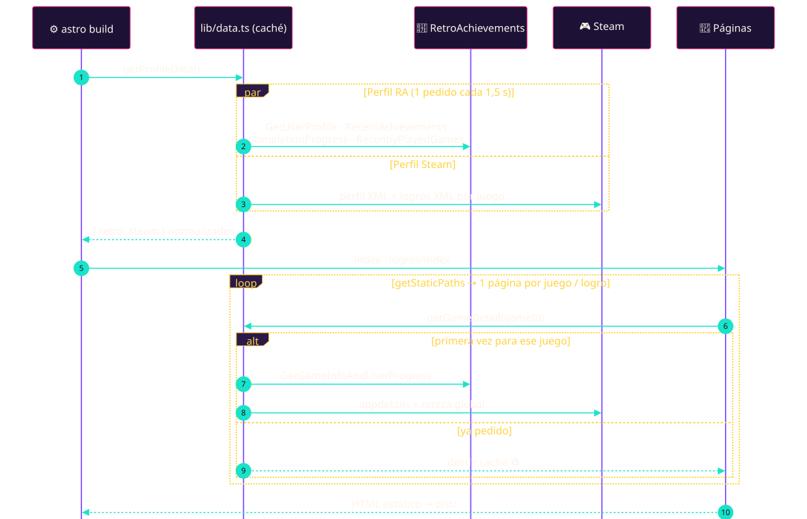

# 🕹️ ZAR · Perfil Gamer Neo-Retro

> **PRESS START** ▶️ — Sitio 100 % estático con el perfil gamer de **Zar**: brief, juegos y logros de **Steam** 🎮 y **RetroAchievements** 👾, todo con onda synthwave / neo-retro 🌴🌅.

```
   ███████╗ █████╗ ██████╗
   ╚══███╔╝██╔══██╗██╔══██╗     🏆 Achievement unlocked:
     ███╔╝ ███████║██████╔╝        "Leíste el README"
    ███╔╝  ██╔══██║██╔══██╗        +10 pts · 0,1 % de los devs lo tiene
   ███████╗██║  ██║██║  ██║
   ╚══════╝╚═╝  ╚═╝╚═╝  ╚═╝
```

> *"It's dangerous to go alone! Take this."* 🗡️ → este README.

---

## 📼 Índice

1. [¿Qué es esto?](#-qué-es-esto)
2. [Quick start (soplá el cartucho)](#-quick-start-soplá-el-cartucho)
3. [Variables de entorno](#-variables-de-entorno)
4. [Arquitectura en 1 imagen](#-arquitectura-en-1-imagen)
5. [Flujo de datos](#-flujo-de-datos)
6. [Comportamiento en el navegador](#-comportamiento-en-el-navegador)
7. [Modelo de datos](#-modelo-de-datos)
8. [Árbol de componentes](#-árbol-de-componentes)
9. [Mapa de archivos (hasta el átomo)](#-mapa-de-archivos-hasta-el-átomo)
10. [Convenciones de código](#-convenciones-de-código)
11. [APIs, límites y caché](#-apis-límites-y-caché)
12. [Seguridad de las keys](#-seguridad-de-las-keys)
13. [Deploy](#-deploy)
14. [Troubleshooting](#-troubleshooting)

---

## 🎮 ¿Qué es esto?

Un portfolio gamer **estático**: HTML + CSS + un poquito de JS. Nada de servidor en producción.

| Página | Ruta | Qué muestra |
|---|---|---|
| 🏠 Home | `/` | Hero synthwave, **Brief** (plataformas, favoritos, timeline) y **Juegos** paginados |
| 🏆 Logros | `/logros/` | Cuentas de Steam/RA (último juego, Rich Presence) + todos los logros con filtro, buscador y paginación |
| 🎲 Juego | `/juegos/:id/` | Tarjeta flotante con la portada, ficha, valoración, capturas y **todos** los logros del juego |
| ⭐ Logro | `/logros/:id/` | Medalla flotante, detalles, rareza, juego y logros relacionados |

Hoy el build genera **~575 páginas** (2 listados + 73 juegos + 500 logros).

> 🧠 **La idea clave:** los datos se piden a las APIs **al compilar** (`npm run build`), no en el navegador. El visitante recibe HTML ya armado y las API keys **nunca** llegan al cliente.

---

## 💾 Quick start (soplá el cartucho)

> 🌬️ *Paso 0: soplar el cartucho. No sirve para nada, pero es tradición.*

```bash
npm install
cp .env.example .env      # y completá tus datos
npm run dev               # http://localhost:4321
```

| Comando | Qué hace |
|---|---|
| `npm run dev` | Servidor de desarrollo con recarga en caliente. Pide datos en cada request (con caché de 5 min) |
| `npm run build` | Genera el sitio estático en `dist/`. Tarda ~2 min por el ritmo de pedidos a RA ⏳ |
| `npm run preview` | Sirve `dist/` tal cual quedaría publicado (no llama a ninguna API) |
| `npm run docs:diagrams` | Vuelve a renderizar `docs/diagrams/*.mmd` → `*.svg` con el tema retro. Usa tu Chrome/Edge instalado |

> ⚠️ Sin keys el sitio **igual compila**: muestra datos de demo y un aviso "⚠ Datos de demo". Nunca un Game Over por falta de config.

---

## 🔑 Variables de entorno

Archivo `.env` (no se sube al repo). Plantilla en [`.env.example`](.env.example).

| Variable | Obligatoria | Default | Para qué |
|---|:---:|---|---|
| `RA_USERNAME` | ✅ | — | Usuario de RetroAchievements |
| `RA_API_KEY` | ✅ | — | Web API key de RA ([Settings → Keys](https://retroachievements.org/settings)) |
| `STEAM_ID` | ✅ | — | SteamID64 (17 dígitos) o URL personalizada |
| `STEAM_API_KEY` | ➖ | — | Opcional. Con key se ven **todos** los juegos y la fecha de última sesión |
| `MAX_ACHIEVEMENTS` | ➖ | `500` | Máximo de logros en el listado de `/logros/` (las páginas de detalle existen para todos) |
| `RECENT_MINUTES` | ➖ | `1051200` (2 años) | Ventana de logros recientes de RA. 1 día = `1440` |

> 🕹️ ↑ ↑ ↓ ↓ ← → ← → B A — el código Konami no desbloquea nada acá, pero las keys sí.

---

## 🗺️ Arquitectura en 1 imagen



<sub>📝 Fuente: [`docs/diagrams/01-arquitectura.mmd`](docs/diagrams/01-arquitectura.mmd)</sub>

---

## 🌊 Flujo de datos

### Del build a las páginas



<sub>📝 Fuente: [`docs/diagrams/02-secuencia-build.mmd`](docs/diagrams/02-secuencia-build.mmd)</sub>

### Cómo se normaliza cada fuente

Dos APIs que no se parecen en nada (JSON de RA vs XML de Steam) terminan en **los mismos tipos**. Por eso ningún componente sabe ni le importa de dónde viene un logro 🤝.



<sub>📝 Fuente: [`docs/diagrams/03-normalizacion.mmd`](docs/diagrams/03-normalizacion.mmd)</sub>

### ¿Y si algo falla? 💀



<sub>📝 Fuente: [`docs/diagrams/04-fallos.mmd`](docs/diagrams/04-fallos.mmd)</sub>

> *"The princess is in another castle"* 🍄 — pero el build **nunca** se rompe por una API caída.

---

## ⚡ Comportamiento en el navegador

El único JS del sitio son dos scripts chiquitos. Todo lo demás es HTML.

### `collection.ts` — filtro + búsqueda + paginación

Se engancha a cualquier sección con `data-collection`. El HTML ya sale del build con la página 1 visible, así que no hay parpadeo y sin JS se ve igual la primera página.



<sub>📝 Fuente: [`docs/diagrams/05-estados-coleccion.mmd`](docs/diagrams/05-estados-coleccion.mmd)</sub>

| Detalle | Cómo |
|---|---|
| 🔎 Búsqueda | Sin tildes ni mayúsculas (`NFD` + `toLowerCase`). El texto de cada tarjeta se normaliza una sola vez |
| 🏷️ Filtro | Genérico por `data-group`: plataforma (`Game Boy`, `PlayStation 2`, `PC · Steam`…, con su icono) o estado (`unlocked` / `locked`) |
| 📜 Scroll | Al paginar **no** salta al encabezado: se compensa la diferencia de alto entre páginas |
| ♿ Accesibilidad | Filtros con `aria-pressed`, paginador con `aria-current="page"` |

### `image-fallback.ts`

``: si la portada vertical de Steam no existe para un juego, se cambia por el header horizontal. Contempla el caso en que la imagen ya falló antes de que cargue el script.

---

## 🧬 Modelo de datos

Todo vive en [`src/lib/types.ts`](src/lib/types.ts).



<sub>📝 Fuente: [`docs/diagrams/06-modelo-datos.mmd`](docs/diagrams/06-modelo-datos.mmd)</sub>

**IDs** (también son las URLs):

| Tipo | Formato | Ejemplo |
|---|---|---|
| Juego RA | `retro-<GameID>` | `/juegos/retro-534/` |
| Juego Steam | `steam-<appid>` | `/juegos/steam-1774580/` |
| Logro RA | `retro-<AchievementID>` | `/logros/retro-5760/` |
| Logro Steam | `steam-<appid>-<apiname>` | `/logros/steam-1774580-achievement_goscc_a1/` |

---

## 🌳 Árbol de componentes



<sub>📝 Fuente: [`docs/diagrams/07-arbol-componentes.mmd`](docs/diagrams/07-arbol-componentes.mmd)</sub>

**Niveles** (de grande a chico):

| Nivel | Carpeta | Ejemplo | Regla |
|---|---|---|---|
| 📄 Página | `src/pages/` | `juegos/[id].astro` | Pide datos, arma *view models*, compone secciones. Sin CSS propio |
| 🟪 Layout | `src/layouts/` | `Base.astro` | `<html>`, `<head>`, nav y footer |
| 🧩 Sección | `components/<feature>/` | `GameGrid`, `DetailHero` | Un bloque con sentido propio (`<section>`/`<header>`) |
| ⚛️ Átomo | `components/ui/` | `ChipList`, `StatList` | Reutilizable, sin datos de negocio, recibe listas por props |

---

## 🗂️ Mapa de archivos (hasta el átomo)

```
portfolio-retro-gamer/
├── 📄 astro.config.mjs        output: 'static'
├── 📄 .env.example            plantilla de variables
├── 📄 .puppeteerrc.cjs        evita que Puppeteer descargue un Chrome propio
├── 📁 docs/
│   ├── render-diagrams.mjs    .mmd → .svg (npm run docs:diagrams)
│   └── 📁 diagrams/
│       ├── 01…07-*.mmd        📝 fuente de cada diagrama (Mermaid)
│       ├── 01…07-*.svg        🖼️ render que muestra este README
│       └── mermaid.config.json  tema neo-retro (colores y tipografía)
├── 📁 public/
│   └── favicon.svg            sol synthwave 🌅
└── 📁 src/
    ├── env.d.ts               tipos de import.meta.env
    ├── 📁 data/
    │   └── profile.ts         ✏️ TODO el contenido escrito a mano
    ├── 📁 lib/                🏗️ solo corre en el build
    ├── 📁 scripts/            ⚡ solo corre en el navegador
    ├── 📁 styles/
    │   └── global.css         tokens, reset y utilidades
    ├── 📁 layouts/
    │   └── Base.astro
    ├── 📁 pages/              🛣️ cada archivo = una ruta
    └── 📁 components/
        ├── site/  home/  games/  achievements/
        ├── profile/  detail/  collection/
        └── ui/                ⚛️ átomos
```

### ✏️ `src/data/`

| Archivo | Qué es |
|---|---|
| [`profile.ts`](src/data/profile.ts) | Handle, tagline, bio (oculta por ahora), favoritos, timeline, `steamGames` (appids extra para Steam sin key), `platforms` (solo extras: las plataformas salen solas de Steam + las consolas con progreso en RA, con su icono) y `hiddenPlatforms`. **Es el único archivo que hay que tocar para cambiar textos** |

### 🏗️ `src/lib/` — lógica de build

| Archivo | Responsabilidad |
|---|---|
| [`types.ts`](src/lib/types.ts) | Contratos de datos compartidos (ver [Modelo de datos](#-modelo-de-datos)) |
| [`config.ts`](src/lib/config.ts) | Lee `MAX_ACHIEVEMENTS` y `RECENT_MINUTES` con defaults seguros |
| [`http.ts`](src/lib/http.ts) | `get()` con timeout y **enmascarado de keys**, `HttpError`, `createRateLimiter`, `withRetry` (respeta `Retry-After`), `decodeEntities` |
| [`retroachievements.ts`](src/lib/retroachievements.ts) | `getRetroData()` (perfil, logros recientes, progreso, último juego) y `getRetroGameDetail()` (ficha + todos los logros con rareza) |
| [`steam.ts`](src/lib/steam.ts) | `getSteamData()` vía XML público o Web API, `getSteamGameDetail()` (tienda + rareza global), `steamAchievementId()` |
| [`retroachievementsPresence.ts`](src/lib/retroachievementsPresence.ts) | Parsea el Rich Presence de RA: `"Samus is in Norfair \| Energy: [177/399]"` → titular + campos |
| [`details.ts`](src/lib/details.ts) | `buildGameDetail()`: elige la fuente y arma una ficha básica si la API falla |
| [`data.ts`](src/lib/data.ts) | **Punto de entrada para las páginas.** Caché por clave (`cached`), `getProfileData`, `getGames`, `getGameDetail`, `getAchievementList`, `getAchievementDetail` |
| [`demo.ts`](src/lib/demo.ts) | Datos de relleno cuando faltan keys o una fuente falla |
| [`format.ts`](src/lib/format.ts) | Fechas, números, %, etiquetas (`AWARD_LABELS`, `rarityLabel`…), `sourceOptions`, `definedStats` |
| [`url.ts`](src/lib/url.ts) | `url()`: respeta el `base` de Astro (necesario en GitHub Pages) |

### ⚡ `src/scripts/` — JS de cliente

| Archivo | Responsabilidad |
|---|---|
| [`collection.ts`](src/scripts/collection.ts) | Filtro + búsqueda + paginación. Se autoinicializa al importarse |
| [`image-fallback.ts`](src/scripts/image-fallback.ts) | Cambia `src` por `data-fallback` si la imagen no carga |
| [`live-status.ts`](src/scripts/live-status.ts) | Cada 60 s pide `/partials/cuentas/` y reemplaza las tarjetas de cuenta del Brief (status en vivo) |
| [`flip-card.ts`](src/scripts/flip-card.ts) | Da vuelta las tarjetas `[data-flip]` con click, Enter o Espacio |

### 🛣️ `src/pages/` — rutas

| Archivo | Ruta | Notas |
|---|---|---|
| [`index.astro`](src/pages/index.astro) | `/` | Hero + Brief + GameGrid |
| [`logros/index.astro`](src/pages/logros/index.astro) | `/logros/` | AccountList + AchievementList |
| [`juegos/[id].astro`](src/pages/juegos/[id].astro) | `/juegos/:id/` | `getStaticPaths` lista los juegos; cada página pide **su** ficha |
| [`logros/[id].astro`](src/pages/logros/[id].astro) | `/logros/:id/` | `getStaticPaths` lista **todos** los logros de todos los juegos (desbloqueados o no), así cualquier tarjeta abre su detalle |
| [`partials/cuentas.astro`](src/pages/partials/cuentas.astro) | `/partials/cuentas/` | **Única ruta no estática** (`prerender = false`): función de Vercel que devuelve las tarjetas de cuenta con datos en vivo |

### 🧩 `src/components/`

<details>
<summary><b>site/</b> — piezas globales del sitio</summary>

| Componente | Qué renderiza | Props |
|---|---|---|
| `SiteNav` | Barra fija con logo `ZAR_` y links (marca la sección actual con `aria-current`) | — |
| `SiteFooter` | Créditos, fecha de build y el `PRESS START` titilante | — |
| `PageHeader` | Encabezado con degradé y grilla para páginas internas | `kicker`, `title`, `subtitle?` |

</details>

<details>
<summary><b>home/</b> — portada</summary>

| Componente | Qué renderiza | Props |
|---|---|---|
| `Hero` | Cielo synthwave, sol rayado, piso animado, título y tarjeta con avatar | `retro`, `steam` |
| `Palms` | SVG de palmeras 🌴 (decorativo, `aria-hidden`) | `class?` |
| `HudStats` | Los 4 números del HUD (logros, puntos RA, horas, juegos) | `items` |
| `Brief` | Sección 01: plataformas, favoritos y timeline (la biografía está oculta por ahora) | `platforms` |

</details>

<details>
<summary><b>games/</b> — juegos</summary>

| Componente | Qué renderiza | Props |
|---|---|---|
| `GameGrid` | Sección 02: toolbar + grilla paginada (8 por página) | `games` |
| `GameCard` | `<li>` con arte, plataforma, horas, progreso y distinción. Linkea a `/juegos/:id/` | `game`, `hidden?` |

</details>

<details>
<summary><b>achievements/</b> — logros</summary>

| Componente | Qué renderiza | Props |
|---|---|---|
| `AchievementList` | Listado general paginado (12 por página) | `achievements` |
| `AchievementCard` | `<li>` con insignia, título, descripción, puntos, rareza, fecha y una franja con el **juego al que pertenece** (icono, nombre y plataforma). Modo bloqueado en gris. Es link si existe la página | `achievement`, `group`, `href?`, `showGame?`, `hidden?` |

</details>

<details>
<summary><b>profile/</b> — cuentas</summary>

| Componente | Qué renderiza | Props |
|---|---|---|
| `AccountList` | Grilla de cuentas (en el Brief) con la marca "Datos del build" o "● En vivo" | `sources`, `live?` |
| `AccountCard` | Usuario, estado, último juego y Rich Presence en campos | `source` |

</details>

<details>
<summary><b>detail/</b> — páginas de detalle</summary>

| Componente | Qué renderiza | Props |
|---|---|---|
| `DetailHero` | Cabecera con link de volver, slot `card` y bloque de info (`h1`, lead, link externo) | `backHref`, `backLabel`, `kicker`, `title`, `lead?`, `externalHref?`, `externalLabel?` |
| `FloatCard` | Contenedor que **flota** 🎈 (sube y baja con giro), brillo holográfico y sombra. Si recibe el slot `back`, **se da vuelta** al hacer click con un destello en degradé. Respeta `prefers-reduced-motion` | slot, slot `back?` |
| `GameShowcase` | Portada vertical + progreso dentro de `FloatCard` | `game` |
| `AchievementShowcase` | Medalla con la insignia + puntos dentro de `FloatCard` (marco distinto si es hardcore) | `achievement` |
| `ScreenshotGallery` | Grilla de capturas | `images`, `gameTitle` |
| `GameAchievements` | Todos los logros del juego con filtro Desbloqueados/Bloqueados | `game`, `linkedIds` |
| `RarityMeter` | Nivel de rareza con su color (Común ⚪, Poco común 🟢, Raro 🔵, Épico 🟣, Legendario 🟡), % y barra. Va en el dorso de la tarjeta del logro | `rarity`, `awarded?` |
| `RelatedGame` | Adapta `GameDetail` → `GameCard` | `game` |
| `RelatedAchievements` | Otros logros desbloqueados del mismo juego | `achievements`, `linkedIds` |

</details>

<details>
<summary><b>collection/</b> — controles de listas</summary>

| Componente | Qué renderiza | Props |
|---|---|---|
| `CollectionToolbar` | Botones de filtro con contador + buscador | `options`, `label`, `searchPlaceholder` |
| `Pager` | `<nav>` vacío que llena `collection.ts` (estilos con `:global()`) | `label` |

</details>

<details>
<summary><b>ui/</b> — átomos ⚛️</summary>

| Componente | Qué renderiza | Props |
|---|---|---|
| `SectionTitle` | `<h2>` con degradé, índice y contador opcionales | `id?`, `index?`, `count?` |
| `Prose` | Párrafos de texto (hoy sin uso: es el de la biografía oculta) | `paragraphs` |
| `ChipList` | Lista de pastillas | `items`, `tone?` |
| `PlatformList` | Plataformas con icono, nombre y cantidad de juegos | `items` (`Platform[]`) |
| `StatList` | `<dl>` de dato/valor en cajas tipo textfield | `items`, `layout?` (`fields` \| `rows`) |
| `ProgressBar` | Barra de progreso (`role="progressbar"`) | `value`, `label`, `size?` |
| `Timeline` | `<ol>` de hitos | `items` |

</details>

---

## 📐 Convenciones de código

### Anatomía de un `.astro`: tres bloques, cada uno en lo suyo

```astro
---
// 1️⃣ FRONTMATTER — lógica. Corre en el build.
//    Imports, props, cálculos y listas ya preparadas ("view model").
const { favorites } = profile;
---

<!-- 2️⃣ HTML — solo markup. Recibe valores listos, sin lógica. -->
<ChipList items={favorites} tone="orange" />

<script>
  // 3️⃣ (opcional) JS de cliente: solo imports de src/scripts/
  import '../../scripts/collection';
</script>

<style>
  /* 4️⃣ CSS con alcance limitado al componente */
  .game-grid__list { display: grid; }
</style>
```

| Regla | Por qué |
|---|---|
| 🧮 **Cálculos en el frontmatter**, nunca en el HTML | El template se lee como HTML puro |
| 📋 **Las listas se pasan armadas** a un componente (`<ChipList items={platforms} />`) | El único `.map()` vive dentro del átomo que renderiza la lista. Es la forma de iterar de Astro (como `v-for` en Vue) |
| 🎨 **`<style>` con alcance** al final de cada componente | Astro agrega `data-astro-cid-*`: el CSS de un componente no pisa a otro |
| 🏷️ **Clases BEM**: `bloque__elemento--modificador` | Se entiende qué estila cada regla, aun con alcance |
| 🌐 **Lo global en `global.css`**: tokens (`--pink`, `--sun`…), reset y utilidades (`.container`, `.panel`, `.kicker`, `.synthwave-grid`, `.visually-hidden`, `@keyframes blink`) | Una sola fuente de colores y tipografías; nada de CSS copiado entre componentes |
| 📦 **CSS en archivos compartidos** (`inlineStylesheets: 'never'` en `astro.config.mjs`) | Con miles de páginas de logro, copiar el CSS en cada HTML duplicaba el peso del sitio |
| 🧷 **`:global()`** solo para elementos creados por JS | Esos nodos no reciben el atributo de alcance |
| ♿ **Semántica**: un `<h1>` por página, `h2` → `h3` sin saltos, `<section aria-labelledby>`, listas reales (`ul`/`ol`/`dl`), `<figure>`/`<figcaption>` | Lectores de pantalla y SEO felices |
| 📱 **Responsive**: los ajustes de celular van en `@media (max-width: 640px)` dentro de cada componente | Probado en iPhone (375 px): sin scroll horizontal, grilla de juegos en 2 columnas y tarjeta flotante más chica |

### 🎨 Paleta neo-retro

| Token | Color | Uso |
|---|---|---|
| `--bg` | `#120a22` 🟪 | Fondo noche |
| `--pink` | `#ff2e88` 🩷 | Acentos, bordes |
| `--orange` | `#ff8a3d` 🟧 | Atardecer |
| `--sun` | `#ffd23f` 🟨 | Números, destacados |
| `--teal` | `#19e3c9` 🩵 | Links, kickers |
| `--violet` | `#8a5cff` 🟣 | Sombras duras estilo arcade |

Tipografías: **Bungee** (títulos), **Press Start 2P** (HUD), **Yellowtail** (firma), **Outfit** (texto).

---

## 🌐 APIs, límites y caché

### 👾 RetroAchievements (key obligatoria)

| Endpoint | Para qué | Cuándo |
|---|---|---|
| `API_GetUserProfile` | Avatar, puntos, Rich Presence | 1 vez por build |
| `API_GetUserRecentAchievements` | Logros desbloqueados (ventana `RECENT_MINUTES`) | 1 vez |
| `API_GetUserCompletionProgress` | Progreso por juego (hasta 100) | 1 vez |
| `API_GetUserRecentlyPlayedGames` | Último juego (**opcional**: si falla, solo se pierde ese dato) | 1 vez |
| `API_GetGameInfoAndUserProgress` | Ficha del juego + todos sus logros con rareza y TrueRatio | 1 vez **por juego** |

> 🚦 **Rate limit:** RA corta con `429` y un `Retry-After` que puede llegar a **~500 s**. Por eso:
> - `createRateLimiter(1500)`: **1 pedido cada 1,5 s** a ritmo fijo.
> - `withRetry`: reintenta solo si el `Retry-After` es ≤ 10 s. Si es más largo, usa el fallback.
> - Evitamos `API_GetUserSummary`: tiene un límite propio mucho más estricto.

### 🎮 Steam (sin key)

| Fuente | Para qué |
|---|---|
| `steamcommunity.com/profiles/<id>/?xml=1` | Perfil, estado, juegos jugados recientemente |
| `…/stats/<appid>/achievements/?xml=1` | Logros del juego (desbloqueados y bloqueados) |
| `store.steampowered.com/api/appdetails` | Descripción en español, desarrollador, géneros, Metacritic, capturas |
| `ISteamUserStats/GetGlobalAchievementPercentagesForApp` | Rareza global de cada logro |

Con `STEAM_API_KEY` se usan `GetOwnedGames`, `GetPlayerAchievements` y `GetSchemaForGame` (todos los juegos y la fecha exacta de la última sesión).

> ❌ Sin key, Steam **no** expone la biblioteca completa (redirige a login). Agregá appids a `steamGames` en `profile.ts` para mostrarlos igual.

### ♻️ Caché (`lib/data.ts`)

| Entorno | Comportamiento |
|---|---|
| `build` | Cada dato se pide **una sola vez** y se comparte entre las ~575 páginas |
| `dev` | Se reutiliza **5 min** (1 min si vino degradado) para no comerse un 429 en cada recarga |

---

## 🔐 Seguridad de las keys

> 🛡️ *"All your keys are belong to… nadie."*

1. Las keys solo se leen en `src/lib/` y en el frontmatter, que **corren en Node durante el build**.
2. Astro **no expone** al cliente las variables sin prefijo `PUBLIC_`.
3. `http.ts` enmascara `key=` / `y=` en todos los mensajes de error (`y=***`).
4. `.env` está en `.gitignore`.
5. En CI, las keys van como **secrets** del hosting, nunca en el workflow.

✅ Verificado: el valor de `RA_API_KEY` no aparece en ninguno de los archivos de `dist/`, `.astro/`, cachés de Vite ni logs.

---

## 🚀 Deploy (Vercel + GitHub)

El sitio es estático **salvo una ruta**: `/partials/cuentas/`, que Vercel ejecuta como función para el status en vivo (`@astrojs/vercel` en `astro.config.mjs`).

### Qué se actualiza y cuándo

| Dato | Cómo se actualiza | Frecuencia |
|---|---|---|
| 🟢 Status: Rich Presence, último juego, "Jugando ahora" | Función `/partials/cuentas/` + `src/scripts/live-status.ts` | **En vivo**: cada 60 s mientras la pestaña está abierta |
| 🏆 Logros, juegos, fichas, plataformas | Rebuild completo del sitio | **Lunes, miércoles, viernes y domingo** (06:00 ART) o a mano |

### Status en vivo (cómo no expone la key)

```
Navegador ──cada 60 s──▶ /partials/cuentas/ (función de Vercel, tiene la key)
                              │  caché del CDN: 60 s
                              ├──▶ RetroAchievements (perfil + último juego)
                              └──▶ Steam (perfil XML)
Navegador ◀── HTML de las tarjetas ya armadas (sin key)
```

- El navegador **nunca** habla con RA ni con Steam: si lo hiciera, la key viajaría en el pedido y se vería con F12. Además, Steam bloquea esos pedidos (CORS).
- El CDN de Vercel guarda la respuesta 60 s (`s-maxage=60`): RA recibe **como mucho una ronda de pedidos por minuto**, haya las visitas que haya.
- Si la función no responde (por ejemplo en `npm run preview`), las tarjetas quedan con los datos del build.

### Rebuild programado

[`.github/workflows/scheduled-rebuild.yml`](.github/workflows/scheduled-rebuild.yml) dispara un **Deploy Hook** de Vercel los **lunes, miércoles, viernes y domingos** a las 06:00 (hora Argentina), con el cron `0 9 * * 0,1,3,5`. También se puede correr a mano desde GitHub → *Actions* → *Rebuild programado* → *Run workflow*.

### Pasos para publicar

1. **Importar el repo en Vercel** (*Add New → Project*). Detecta Astro solo; build `npm run build`.
2. **Variables de entorno** en Vercel → *Settings → Environment Variables*: `RA_USERNAME`, `RA_API_KEY`, `STEAM_ID` (y opcionales `STEAM_API_KEY`, `MAX_ACHIEVEMENTS`, `RECENT_MINUTES`).
3. **Deploy Hook** en Vercel → *Settings → Git → Deploy Hooks* (rama `main`). Copiar la URL.
4. **Secret en GitHub** → *Settings → Secrets and variables → Actions*: `VERCEL_DEPLOY_HOOK_URL` con esa URL.

Notas:

- ⏳ **Tiempo de build:** ~3 min por el ritmo de pedidos a RA (1 cada 1,5 s). Normal, no está colgado.
- 🚦 **No encadenar builds:** varios seguidos superan el límite de RA y lo bloquean ~10 min. Ese build no falla: las fichas afectadas salen básicas.
- 🔍 **`npm run preview` no está disponible** con el adapter de Vercel. Para probar la función localmente, usar `npm run dev`.

---

## 🧯 Troubleshooting

| Síntoma | Causa probable | Fix |
|---|---|---|
| "⚠ Datos de demo" en una cuenta | Faltan keys o la API falló | Revisá `.env` y el log (`[retroachievements] usando datos de demo → …`) |
| `HTTP 429 (Retry-After: 519s)` | Superaste el límite de RA | Esperá lo que indica y no recargues dev en bucle 🙃 |
| `[detalle] <juego>: …` en el build | Falló la ficha de ese juego | La página sale con ficha básica. Volvé a compilar más tarde |
| Cambié algo en la API y no lo veo en dev | Caché de 5 min | Esperá o reiniciá `npm run dev` |
| Steam muestra pocos juegos | Sin key solo se ven los recientes | `STEAM_API_KEY` o `steamGames` en `profile.ts` |
| Estilos raros después de mover componentes | Caché de Vite en dev | Reiniciá el servidor |

---

```
  ╔═══════════════════════════════╗
  ║      GAME OVER?  NO WAY.      ║
  ║                               ║
  ║    CONTINUE?   ▶ YES    NO    ║
  ║               9...            ║
  ╚═══════════════════════════════╝
```

> Hecho con 💖, ☕ y demasiadas horas de synthwave por **Zar**. *Do a barrel roll!* 🛩️
